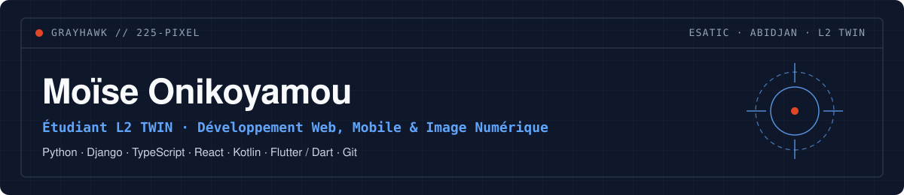

# Moïse Onikoyamou

Étudiant en Licence 2 **TWIN** (Technologies Web et Image Numérique) à l’**ESATIC** (Abidjan, Côte d’Ivoire). Je développe des projets web, mobile et backend — notamment avec Python/Django dans le cadre du projet de groupe **TaskLab**, ainsi que des applications React/TypeScript, Flutter/Dart et Android/Kotlin.

- **Portfolio en ligne** : [grayhawk225-pixel.github.io/Mon_Portfolio](https://grayhawk225-pixel.github.io/Mon_Portfolio/)
- **Localisation** : Abidjan, Côte d’Ivoire

## Compétences & outils

